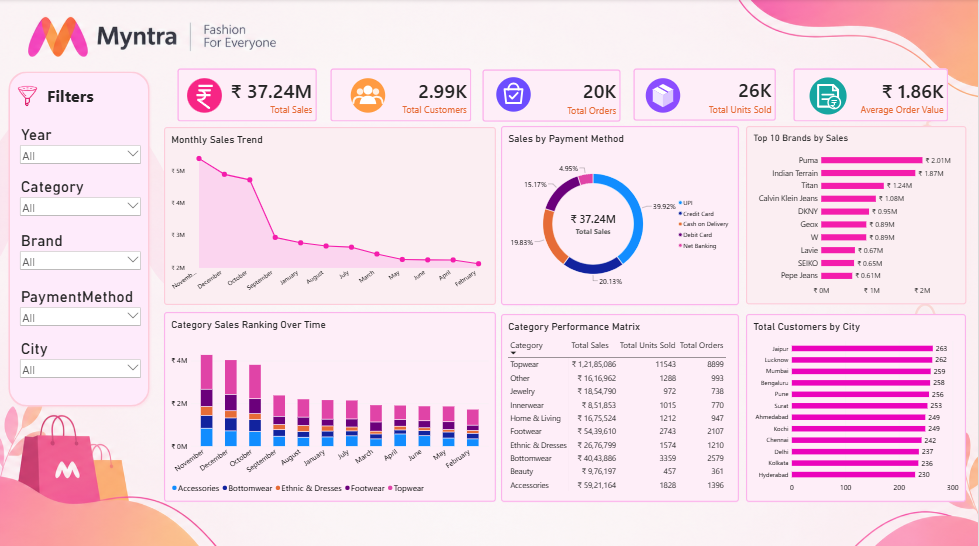

# 🛍️ Myntra Sales & Customer Analytics Dashboard | Power BI

## 📌 Project Overview

This project focuses on analyzing Myntra's sales and customer data using Microsoft Power BI to understand business performance, identify sales trends, and generate meaningful insights.

An interactive dashboard was developed to monitor key business metrics, analyze brand and category performance, understand customer distribution across cities, and evaluate payment preferences.

The objective is to transform raw data into actionable business insights that can support data-driven decision-making.

## 🎯 Business Objectives

- Monitor overall sales, customer, and order performance.
- Analyze monthly sales trends and performance variations.
- Identify top-performing brands based on sales.
- Evaluate category-wise sales and order performance.
- Understand customer distribution across different cities.
- Analyze customer payment preferences.
- Provide an interactive view of business performance using Power BI.

## 🛠️ Tools & Technologies

| Tool | Purpose |
|---|---|
| Microsoft Power BI | Dashboard development and visualization |
| Power Query | Data cleaning and transformation |
| DAX | KPI calculations and analytical measures |
| Data Modeling | Organizing data and establishing relationships |
| Excel / CSV | Data source and preparation |

## 📊 Dashboard Overview

The dashboard provides a consolidated view of Myntra's business performance through interactive visualizations and KPI cards.



### Key Performance Indicators (KPIs)

The dashboard displays the following key metrics:

| KPI | Dashboard Value |
|---|---:|
| Total Sales | ₹37.24M |
| Total Customers | 2.99K |
| Total Orders | 20K |
| Total Units Sold | 26K |
| Average Order Value | ₹1.86K |

*Values represent the dashboard snapshot and may change based on applied filters.*

## 📈 Dashboard Features & Analysis

### 1. Monthly Sales Trend
- Analyzes sales performance across months.
- Helps identify changes and variations in sales.
- Supports monitoring of monthly business performance.

### 2. Sales by Payment Method
- Analyzes sales contribution across different payment methods.
- Compares Credit Card, UPI, Cash on Delivery, Debit Card, and Net Banking.
- Helps understand customer payment preferences.

### 3. Top 10 Brands by Sales
- Ranks brands based on their sales performance.
- Identifies leading brands.
- Helps compare brand-level contributions.

### 4. Category Sales Ranking Over Time
- Compares sales performance across product categories.
- Visualizes category rankings across months.
- Helps identify categories contributing to overall sales.

### 5. Category Performance Matrix
- Provides a comparative view of category-level sales.
- Displays Total Sales, Total Units Sold, and Total Orders.
- Supports evaluation of category performance.

### 6. Customer Distribution by City
- Analyzes customer distribution across different cities.
- Identifies cities with higher customer counts.
- Helps understand geographical customer distribution.

## 💡 Key Business Insights

Based on the displayed dashboard:

1. **Sales Performance:** The dashboard reports total sales of ₹37.24M, with approximately 20K orders.

2. **Brand Performance:** Puma leads the displayed Top 10 brands with approximately ₹2.01M in sales, followed by Indian Terrain at ₹1.87M.

3. **Payment Preferences:** Credit Card contributes approximately 39.92% of sales, making it the largest payment-method segment in the dashboard.

4. **Category Performance:** The category performance matrix enables comparison of sales, units sold, and orders to identify stronger and weaker categories.

5. **Geographical Distribution:** Jaipur and Lucknow have the highest displayed customer counts, with 263 and 262 customers respectively.

## 🎛️ Interactive Features

- Year-based filtering.
- Category-based filtering.
- Brand-based filtering.
- Payment method filtering.
- City-based filtering.
- Interactive cross-filtering across dashboard visuals.

## 📂 Project Structure

```text
Myntra-Sales-Analytics-Dashboard/
│
├── Dashboard/
│   └── Myntra_Dashboard.pbix
│
├── Screenshots/
│   └── dashboard_overview.png
│
├── Dataset/
│   └── customers_cleaned.csv
│   └── myntra_catalog_cleaned.csv
│   └── orders_cleaned.csv
│
└── README.md
```

## 🚀 How to Explore the Project

1. Clone or download this repository.
2. Download and install Microsoft Power BI Desktop.
3. Open the `.pbix` file.
4. If prompted, update the dataset file paths.
5. Refresh the data if the source files are available.
6. Explore the dashboard using the interactive filters.

## 📚 Skills Demonstrated

- Data Cleaning and Transformation
- Power Query
- Data Modeling
- DAX Measures
- KPI Development
- Business Intelligence
- Data Visualization
- Business Analysis
- Analytical Thinking

## 👩‍💻 Author

**Vaishnavi Sarode**

Aspiring Data Analyst | Power BI | SQL | Python | Excel

- LinkedIn: [LinkedIn Profile URL](https://www.linkedin.com/in/vaishnavi-sarode-274800391/)
- GitHub: [GitHub Profile URL](https://github.com/Vaishnavisarode/)

---

⭐ If you find this project interesting, feel free to explore the repository and share your feedback!
